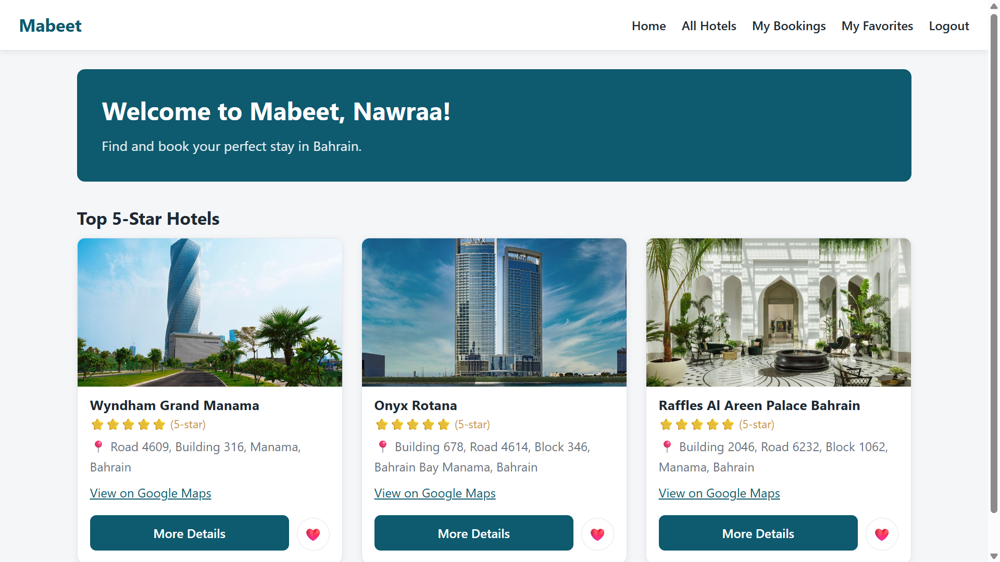
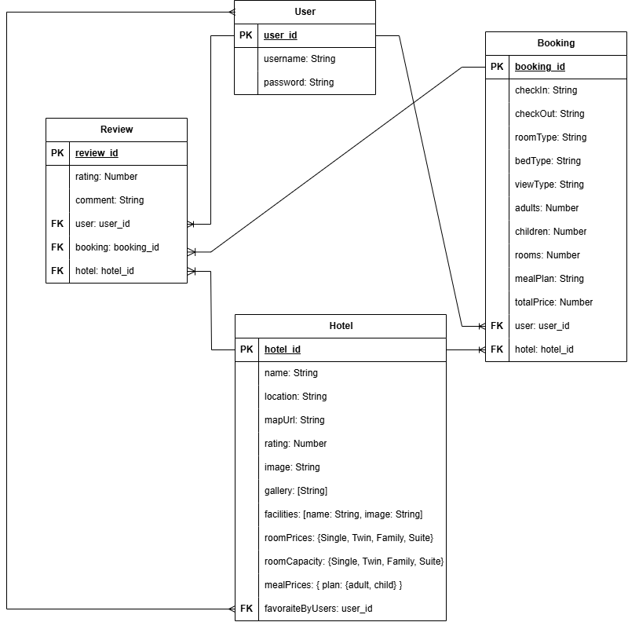

# Mabeet: Hotel Booking Management App 🏨

Mabeet is a hotel booking website for hotels in Bahrain. You can browse hotels, look at their photos and facilities, see where they are on a map, and book a room. I built it with Node.js, Express, MongoDB and EJS.

## Screenshots



## Technologies Used

- Node.js and Express
- MongoDB with Mongoose
- EJS for the pages
- express-session and connect-mongo for login sessions
- bcrypt for hashing passwords
- method-override for PUT and DELETE forms
- SweetAlert2 for alerts
- Leaflet with OpenStreetMap for the hotel map
- HTML and CSS

## User Stories

- As a visitor, I want to browse hotels and see their photos, facilities and location, so I can choose where to stay.
- As a visitor, I want to create an account and log in, so I can book rooms.
- As a customer, I want to pick a room type, dates, guests and a meal plan and see the total price, so I know what I am paying.
- As a customer, I want to view, edit and cancel my bookings, so I can change my plans.
- As a customer, I want to write a review after my stay, so I can share my experience.
- As a customer, I want to read other guests' reviews, so I can pick a good hotel.
- As a customer, I want to save hotels to my favorites, so I can find them again quickly.

## Database Design



### Relationships

- **User → Booking:** One user can have many bookings. Each booking belongs to one user.
- **Hotel → Booking:** One hotel can have many bookings. Each booking belongs to one hotel.
- **User → Review:** One user can write many reviews. Each review belongs to one user.
- **Hotel → Review:** One hotel can have many reviews. Each review belongs to one hotel.
- **Booking → Review:** Each booking can have one review after check-out.
- **User ↔ Hotel Favorites:** Users can favorite many hotels, and hotels can be favorited by many users.

## Routes

Routes marked with 🔒 need you to be logged in.

| Method | Route                       | Description                             |
| ------ | --------------------------- | --------------------------------------- |
| GET    | /                           | Home page                               |
| GET    | /auth/sign-up               | Sign up form                            |
| POST   | /auth/sign-up               | Create account                          |
| GET    | /auth/sign-in               | Log in form                             |
| POST   | /auth/sign-in               | Log in                                  |
| GET    | /auth/sign-out              | Log out                                 |
| GET    | /hotels                     | List all hotels                         |
| GET    | /hotels/favorites           | 🔒 List your favorite hotels            |
| GET    | /hotels/:hotelId            | View hotel details and booking form     |
| POST   | /hotels/:hotelId/book       | Check booking details and go to payment |
| GET    | /hotels/:hotelId/reviews    | View a hotel's reviews                  |
| POST   | /hotels/:hotelId/favorite   | 🔒 Add hotel to favorites               |
| POST   | /hotels/:hotelId/unfavorite | 🔒 Remove hotel from favorites          |
| GET    | /bookings/payment           | 🔒 Payment page                         |
| POST   | /bookings/payment           | 🔒 Pay and create booking               |
| GET    | /bookings                   | 🔒 List your bookings                   |
| GET    | /bookings/:bookingId        | 🔒 View booking                         |
| GET    | /bookings/:bookingId/edit   | 🔒 Edit booking form                    |
| PUT    | /bookings/:bookingId        | 🔒 Update booking                       |
| DELETE | /bookings/:bookingId        | 🔒 Cancel booking                       |
| GET    | /reviews/new/:bookingId     | 🔒 New review form                      |
| POST   | /reviews                    | 🔒 Create review                        |
| GET    | /reviews/:reviewId/edit     | 🔒 Edit review form                     |
| PUT    | /reviews/:reviewId          | 🔒 Update review                        |
| DELETE | /reviews/:reviewId          | 🔒 Delete review                        |

## Getting Started

1. Clone the repo and go into the project folder.
2. Install the dependencies:

   ```bash
   npm install
   ```

3. Make a `.env` file in the project root (see below).
4. Add the hotels to the database (you only need to do this once):

   ```bash
   node seed.js
   ```

5. Start the app:

   ```bash
   npm run dev
   ```

   or `npm start` if you don't have nodemon.

6. Open `http://localhost:3000` in your browser.

## Environment Variables

Your `.env` file needs these values:

```
MONGODB_URI=your-mongodb-connection-string
SESSION_SECRET=your-secrite-key
PORT=3000
```

`PORT` is optional. If you leave it out, the app uses 3000.

## Features

- Sign up, log in and log out
- Browse all hotels and open a details page for each one
- See each hotel's location on a map (details page only), plus a Google Maps link
- Book a room: pick the room type, dates, number of guests and a meal plan
- Simple payment step to confirm the booking
- View, edit and cancel your bookings
- Write, edit and delete reviews for hotels you booked
- Add hotels to your favorites
- Pop-up alerts for success messages and confirmations

## Future Enhancements

- Search and filter hotels by name, location, star rating or price.
- An admin page to add and edit hotels from the website.

## References

- [SweetAlert2](https://sweetalert2.github.io/): used for the success pop-ups and the "are you sure?" confirmations (for example when cancelling a booking or deleting a review).
- [Leaflet](https://leafletjs.com/): used to show the map with the hotel's marker on the hotel details page.
- [OpenStreetMap](https://www.openstreetmap.org/): the map tiles Leaflet shows on the details page.

## Credits

- Developed by: Nawraa Ahmed
- Course Instructor: Omar Kamal
- Associate Instructor: Ayah Meftah
